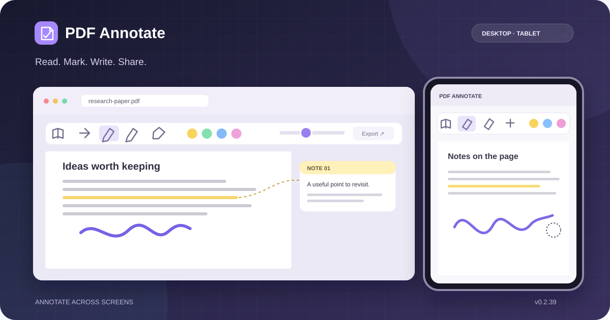

<div align="center">

<h1>PDF Annotate</h1>

<p><strong>在 Obsidian 中阅读、批注与分享 PDF</strong></p>

<p>
  
  
  
</p>

<p>
  <a href="#功能一览">功能一览</a> ·
  <a href="#多端适配">多端适配</a> ·
  <a href="#安装方法">安装方法</a> ·
  <a href="#导出与分享">导出与分享</a>
</p>



<sub>界面示意图：用于展示功能布局，并非应用实机截图。</sub>

</div>

> [!NOTE]
> **多端适配**：桌面端支持 PDF / EPUB 批注；iPad 与安卓平板重点适配 PDF 批注。移动端 EPUB 尚未做专项适配。

## 功能一览

| 功能 | 可以做什么 |
| --- | --- |
| **文本标记** | 高亮、下划线、删除线；用颜色区分重点。 |
| **手写与擦除** | 自由画笔添加笔迹，橡皮擦点击或按住拖动可擦除碰到的笔迹段。 |
| **文字批注** | 在页边添加浮动批注框，也可添加不关联正文的独立批注。 |
| **查找与整理** | 搜索 PDF / EPUB 正文；通过批注侧栏定位、编辑标记和批注。 |
| **撤销与重做** | 对标记、画笔和批注框进行多步撤销与重做。 |
| **PDF 分享导出** | 保留原文的矢量清晰度与可搜索文字，导出可分享的批注 PDF。 |
| **网页章节预览** | 可选的实验功能：将 PDF 目录与网页章节匹配，在正文旁预览并为导出 PDF 添加链接。 |

橡皮擦只处理插件创建的手写笔迹；PDF 原文、文字标记和批注框不会被橡皮擦删除。原始 PDF 不会因批注或导出而被覆盖。

## 多端适配

| 平台 | 阅读与批注 | 输入方式 |
| --- | --- | --- |
| **桌面端** | PDF / EPUB；搜索、标记、手写、批注侧栏 | 鼠标与键盘；PDF 橡皮擦支持按住拖动 |
| **iPad / 安卓平板** | 重点适配 PDF；悬浮工具栏可横向滑动 | 默认手写笔画写、手指滚动；可在设置中开启手指绘制 |

平板首次打开 PDF 时默认进入阅读模式。点击模式按钮后选择画笔、橡皮擦或文本工具；阅读时切回阅读模式可减少误触。长按选中文字后，可使用弹出的批注工具。页外批注框支持触控拖动和调整大小。

画笔粗细可在 **0.5–30** 间调节，橡皮擦直径可在 **1–30** 间调节。平板的粗细面板提供笔迹预览、滑块、数值和微调按钮。没有手写笔时，可在插件设置中开启「平板手指绘制」。

## 导出与分享

<div align="center">
  
  <br><sub>流程示意图：批注单独保存，导出时生成新的 PDF。</sub>
</div>

在插件设置中开启 **「显示 PDF 导出按钮」**，桌面和平板 PDF 工具栏会出现分享图标。导出文件与原 PDF 保存在同一文件夹，命名为 `原名-annotated.pdf`。

导出时不会把整页原文压成图片：文字仍可复制和搜索。高亮、手写笔迹写为标准 PDF 批注，可在支持批注的阅读器中删除；有页边文字批注的页面会向右扩展，保留原文大小，在新增区域显示批注卡片。批注全文也写入 PDF 便笺。旋转页面目前仅显示便笺，不显示右侧卡片。

## 网页章节预览

这是**实验功能**。在插件设置中开启「实验功能：网页章节链接」后，PDF 工具栏最右侧会出现网页按钮。为当前 PDF 填入网址，可选择按 PDF 目录标题自动匹配网页章节，也可逐章手动填写。

自动匹配会抓取一次网页 HTML，只保存成功匹配的章节网址，不保存 HTML。已匹配章节会在正文旁显示预览标志；可就近预览、放大，网站禁止内嵌时可在浏览器打开。导出的 PDF 会为这些章节添加可点击的网页链接。PDF 没有目录或网页目录由脚本生成时，自动匹配可能没有结果。

<details>
<summary>兼容性与真机测试说明</summary>

移动端 PDF 已针对 iPad 和安卓平板的触控问题进行修正，但不同 Obsidian、iPadOS 和安卓 WebView 版本的手写笔与选字行为可能不同。建议先用测试 PDF 检查连续画线、手指滚动、橡皮擦拖动、选字、高亮、屏幕旋转以及重新打开后的批注位置。iPad 若出现系统「随手写」与画笔争夺输入，可尝试在系统设置中关闭「随手写」后重试。

</details>

## 安装方法

### 方式一：手动安装（推荐，当前分发方式）

1. 下载本仓库的 `main.js`、`manifest.json`、`styles.css`、`versions.json` 四个文件。
2. 在 Obsidian 库目录下创建文件夹：
   ```
   <你的库>/.obsidian/plugins/PDF Annotate/
   ```
   （文件夹名必须和 `manifest.json` 里的 `id` 一致，即 `PDF Annotate`，含空格）
3. 把四个文件复制进去。
4. 打开 Obsidian → 设置 → 第三方插件 → 关闭"安全模式" → 在已安装列表里启用 **PDF批注 PDF Annotate**。
5. 重启 Obsidian 生效。

### 方式二：BRAT（Beta Reviewer's Auto-update Tool）

> 推荐给想跟最新版的用户。BRAT 安装的是**仓库地址**而非下载包，以后本仓库一更新，你只需在 BRAT 里点一下更新，不用重新下载安装。

1. 在 Obsidian 社区插件市场安装 **BRAT**（搜 "BRAT"）。
2. 打开 BRAT 设置 → `Add a beta plugin by its GitHub repository` → 填入：
   ```
   github:ya886ya/obsidian-pdf-annotate
   ```
3. 添加后启用 **PDF批注 PDF Annotate**，重启 Obsidian 生效。
4. **以后更新**：仓库推送新版本后，回到 BRAT 列表里该插件项点 **Update**（或开启 BRAT 自动更新）。BRAT 会拉取 `main` 分支根目录最新的 `main.js` / `manifest.json` / `styles.css` / `versions.json` 并覆盖本地，**无需重新下载安装**。更新后若 Obsidian 没自动重载，去「设置 → 第三方插件」把该插件关一下再开（或重启 Obsidian）即可。

> 说明：本插件未上架 Obsidian 官方社区插件列表，仅通过此 GitHub 仓库 + BRAT / 手动方式分发。

---

## 版本更新记录（Changelog）

版本号按实际发布递增；本次平板适配及后续修复合并为 0.2.39。

### v0.2.39（当前版本）

- 允许在 Obsidian 移动版安装，PDF 阅读器增加平板工具栏、手写笔与手指分工及防误触的阅读模式默认值。
- PDF 画笔、橡皮擦和页外批注框支持触控事件；单点笔迹可保存；文本选区增加触控结束时的批注入口。
- 平板窄屏上的工具栏、选区弹窗与批注框尺寸适配；移动端不再改写桌面式的新标签页打开逻辑。
- 粗细控件使用独立弹出面板，提供笔迹预览、滑块、数值和微调按钮；滑块轨道与圆圈对齐。
- 修复 iPad 上手写起笔被 PDF 文字层遮挡、页面重绘后画布引用过期及未正常结束的触控状态；橡皮擦拖动时空心圆持续跟随笔尖。
- 修复桌面端橡皮擦拖动经过 PDF 文字层时中断的问题；按住拖动可连续擦除手写笔迹。
- PDF 分享保留原文矢量清晰度和可搜索文字；高亮、笔迹、便笺及章节网址写入 PDF 批注或链接，多条页边批注可自动排到下一列。

<details>
<summary>查看早期版本更新（v0.2.36–v0.2.38）</summary>

### v0.2.38
相对 v0.2.37 的主要更新：

- **EPUB 图片破图修复**：旧逻辑提前清空相对路径 img 的 src 导致资源解析跳过、正文图全破。改为存 `dataset.daImgSrc` 并优先按文件名全局查找 epub 内图片，成功换 data URL，失败才留占位；封面图也纳入兜底观察。
- **EPUB 章节目录在 OPF 位于 zip 根目录时失效修复**：如李笑来《让时间陪你慢慢变富》OPF 在 `content.opf`（无子目录），旧正则提取 opfDir 失败导致目录为空。改用 `lastIndexOf("/")` 提取，修复后解析出 22 个章节。
- **PDF 文字标记（高亮/下划线/删除线）位置漂移根治**：根因是标记百分比写入的 hl 层自身高度（content box）与旧代码用页面 border box（含 padding/border）归一化基准不一致，产生绕页面中心缩放误差（顶部偏下、底部偏上、中间准）。统一以 hl 层自身 `getBoundingClientRect()` 为基准换算，误差消失；横向同理修掉"下划线偏右"。
- **EPUB 阅读区 Ctrl+滚轮缩放（新增）**：像 PDF 一样用 Ctrl+滚轮放大缩小正文。改 EPUB 正文字号（CSS 变量 `--da-epub-font-size`），不用 `transform:scale`（避免批注 Overlay 错位）；同时复用 Obsidian 原生阅读字号滑块（两套互不冲突）。
- **PDF 已批注区域右键功能框（新增）**：在高亮/下划线/删除线、画笔笔迹、批注框上点右键弹功能框（之前只有选取文字能弹）。可改颜色、切换高亮/下划线/删除线、取消批注、编辑/删除批注框。
- **PDF 单击强制新标签修复**：修复 EPUB/PDF 链接在新标签打开的异常。
- **PDF 右键功能框后台挂久失效修复（v3）**：旧版右键回调用闭包捕获的 `canvas`/`pageEl` 算坐标，Obsidian 后台挂久后原生渲染器重建画布或 layout 未稳定，导致 `getBoundingClientRect()` 返回脏值、mark/pen 命中判定全算到 0 附近，右键弹不出（关文件重开才恢复）。v3 改为右键那一刻从 `ev.target` 实时定位存活页面元素，命中基准用 `.da-native-hl-layer` 自身 rect（与标记漂移修复同源），并加脏值护栏，彻底不依赖闭包旧引用。BUILD 标记 `PDF-CTX-MENU-v3`。

### v0.2.37
相对 v0.2.36 的主要更新：

- **正文搜索功能（新增）**：PDF 与 EPUB 工具栏均加入搜索框，支持输入即搜、回车翻下一处 / Shift+回车上一处、▲▼ 按钮翻页、命中计数显示，并用覆盖层 / 高亮精准标出被搜文字（多轮修复后稳定：EPUB 高亮注入 shadow 生效、PDF 覆盖层跟随页面滚动且坐标对齐、消除敲字跳页与循环高亮消失等问题）。
- **PDF 标记位置漂移根治**：标记（高亮/下划线/删除线）垂直与水平位置与文字严格对齐——根因为覆盖层 / 包裹方案参考系（border box vs content box）错配，改为以文本层真实布局盒 / 覆盖层自身坐标为基准，消除"上偏下、下偏上、中间准"的漂移。
- **EPUB 批注栏按原文顺序排序**：各分组卡片按章节序号 + 章节内字符偏移排列，而非添加时间。
- **EPUB 取消批注卡顿修复**：合并多次同步重渲染为一次（微任务调度），并懒遍历文本节点，消除展开侧栏时取消批注冻结、逐次添加越加越卡的问题；渲染改为增量（仅新增包 / 删除解包 / 未变保留），复杂度从 O(N²) 降为 O(1)。
- **EPUB 批注详情面板改版**：点击卡片不再自动跳转，改为弹出详情面板（顶部显示原文，底部修改批注功能：颜色 / 类型 / 文字 / 保存）；移除了详情面板内的「跳转到对应文字」按钮（点击卡片本就不自动跳正文）。
- **EPUB「其他批注」功能**：新增不关联正文的独立批注，侧栏单列「其他批注」组。
- **EPUB 页码控件对齐 PDF 原生**：当前页改为可编辑输入框，回车跳转、失焦恢复。
- **其他修复**：修复取消跨元素高亮时残留（按标注 id 解包全部分片 span）、修复改色 / 改标记类型后正文不变、修复输入框偶发无法输入（selectionLocked 保护）、移除初次添加弹窗过时提示等。

### v0.2.36（基线版本）
首个带 git tag 的发布版本。包含 PDF / EPUB 批注核心能力：高亮 / 下划线 / 删除线 / 自由画笔 / 橡皮擦 / 页外批注框、颜色预设、撤销重做、批注侧栏分组、双向联动、EPUB 页码显示与跳转等。

</details>

---

## 文件说明

| 文件 | 作用 |
|------|------|
| `main.js` | 插件主体，包含运行所需功能 |
| `manifest.json` | 插件元信息（id / 版本 / 依赖） |
| `styles.css` | 插件样式 |
| `versions.json` | 版本 → 最低 Obsidian 版本映射 |
| `README.md` | 本说明文档 |
| `docs/preview.svg`、`docs/workflow.svg` | README 中的界面与流程示意图 |
| `LICENSE` | CC BY-NC 4.0 授权（禁止商用） |

## 许可

本插件采用 **知识共享署名-非商业性使用 4.0 国际许可协议（CC BY-NC 4.0）**，
**禁止任何商业用途**（包括但不限于销售、付费分发、在商业产品/服务中集成并收费）。

Creative Commons Attribution-NonCommercial 4.0 International Public License
© 2026 ya

完整条款见仓库内 `LICENSE` 文件及 https://creativecommons.org/licenses/by-nc/4.0/legalcode

<details>
<summary>内置 pdf-lib 的 MIT 许可</summary>

MIT License

Copyright (c) 2019 Andrew Dillon

Permission is hereby granted, free of charge, to any person obtaining a copy
of this software and associated documentation files (the "Software"), to deal
in the Software without restriction, including without limitation the rights
to use, copy, modify, merge, publish, distribute, sublicense, and/or sell
copies of the Software, and to permit persons to whom the Software is
furnished to do so, subject to the following conditions:

The above copyright notice and this permission notice shall be included in all
copies or substantial portions of the Software.

THE SOFTWARE IS PROVIDED "AS IS", WITHOUT WARRANTY OF ANY KIND, EXPRESS OR
IMPLIED, INCLUDING BUT NOT LIMITED TO THE WARRANTIES OF MERCHANTABILITY,
FITNESS FOR A PARTICULAR PURPOSE AND NONINFRINGEMENT. IN NO EVENT SHALL THE
AUTHORS OR COPYRIGHT HOLDERS BE LIABLE FOR ANY CLAIM, DAMAGES OR OTHER
LIABILITY, WHETHER IN AN ACTION OF CONTRACT, TORT OR OTHERWISE, ARISING FROM,
OUT OF OR IN CONNECTION WITH THE SOFTWARE OR THE USE OR OTHER DEALINGS IN THE
SOFTWARE.

</details>
